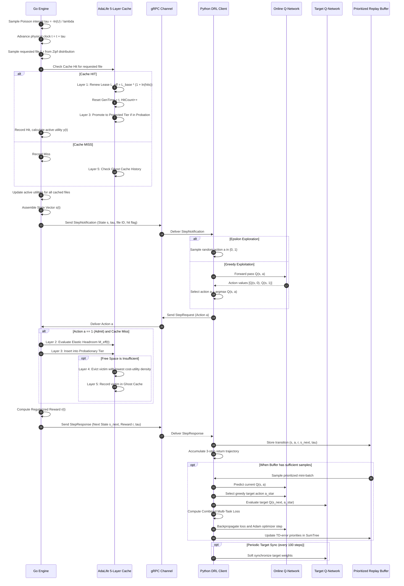

# End-to-End System Architecture & Data Flow Specification

> **Project**: SMDP Edge Caching Framework  
> **Evolution**: From Paper Baseline (Niknia '24 DDQL) to the Complete **AdaLife** Production-Grade Architecture  
> **Core Subsystems**: Discrete-Event SMDP Engine (`simulator-go`) $\Longleftrightarrow$ gRPC IPC $\Longleftrightarrow$ Neural Policy Agent (`agent-python`)

---

## 1. High-Level Architectural Overview

The framework unifies a high-speed, discrete-event caching engine written in Go with an intelligent Deep Reinforcement Learning (DRL) agent written in Python (PyTorch), communicating via high-throughput gRPC protocol buffers over a local IPC socket (`localhost:50051`):

```
┌──────────────────────────────────────────────────────────────────────────────────────────────────┐
│                                       GO SIMULATION ENGINE                                       │
│                                                                                                  │
│   ┌─────────────────────┐       ┌────────────────────────────────────────────────────────────┐   │
│   │ Poisson & Zipf      │ ----> │                   ADALIFE 5-LAYER ENGINE                   │   │
│   │ Traffic Generator   │       │                                                            │   │
│   │ (Heavy-Tailed 70/30)│       │  [L1] AdaLife Dynamic Leases    (Adaptive TTL on Hits)     │   │
│   └─────────────────────┘       │  [L2] Elastic Headroom         (Load-Adaptive +35% M_eff)  │   │
│                                 │  [L3] Two-Tier Probation Shield(15% Probation / 85% Core)  │   │
│                                 │  [L4] Cost-Utility Eviction    (Utility/Size * FetchCost)  │   │
│                                 │  [L5] Counterfactual Ghost ARC (Regret & Fast-Tracking)    │   │
│                                 └────────────────────────────────────────────────────────────┘   │
└────────────────────────────────────────────────┬─────────────────▲───────────────────────────────┘
                                                 │                 │
                           State s(t) in R^(5F+1)│                 │ Action a in {0, 1}
                           Reward r(t), tau      │                 │ (Admit vs. Bypass)
                                                 ▼                 │
┌──────────────────────────────────────────────────────────────────┴───────────────────────────────┐
│                                gRPC IPC LAYER (Protobuf Channel)                                 │
└────────────────────────────────────────────────┬─────────────────▲───────────────────────────────┘
                                                 │                 │
                                                 ▼                 │
┌──────────────────────────────────────────────────────────────────┴───────────────────────────────┐
│                                    PYTHON NEURAL AGENT (PyTorch)                                 │
│                                                                                                  │
│   ┌──────────────────────────────────────────────┐    ┌──────────────────────────────────────┐   │
│   │         DOUBLE DQN (DDQL) / D3QN             │    │    PRIORITIZED REPLAY & SUMTREE      │   │
│   │  • Online Q-Network: θ (Action Selection)    │    │  • Multi-Step Returns (n = 3)        │   │
│   │  • Target Q-Network: θ^- (Evaluation)        │    │  • Eq. (6) Priority: |r - avgR| + TD │   │
│   │  • Dueling Streams: V(s) + (A(s, a) - avg A) │    │  • Dynamic Demonstration Overwriting │   │
│   └──────────────────────────────────────────────┘    └──────────────────────────────────────┘   │
└──────────────────────────────────────────────────────────────────────────────────────────────────┘
```

---

## 2. Foundational Architecture: The Paper Baseline (Niknia et al., 2024)

### 2.1 The Continuous Semi-Markov Decision Process (SMDP)
Traditional caching assumes discrete, synchronous time slots. In reality, user requests arrive asynchronously in continuous physical time. The environment is formalized as a continuous-time SMDP:
* **Event Trigger**: Transitions occur strictly upon the arrival of user request $k$ at timestamp $t_k$.
* **Poisson Inter-Arrival Interval**: The time duration $\tau_k = t_{k+1} - t_k$ between consecutive requests follows an exponential distribution with parameter $\lambda$:
  $$\tau_k = -\frac{\ln(U)}{\lambda}, \quad U \sim \text{Uniform}(0, 1)$$
* **Continuous Discounting**: Because physical time $\tau_k$ varies per transition, the discount factor continuously decays:
  $$\gamma(\tau_k) = \gamma^{\tau_k}, \quad \text{where } \gamma = 0.99$$

### 2.2 Content Modeling & Non-Linear Freshness Decay
Each content item $f \in \{0, 1, \dots, F-1\}$ is characterized by four attributes:
1. **Size ($z_f$)**: Storage footprint in MiB.
2. **Lifetime ($w_l^f$)**: Validity duration in seconds.
3. **Importance ($i_f \in [0.1, 0.9]$)**: Content quality-of-service weighting.
4. **Generation Timestamp ($w_g^f$)**: The time the file was fetched from origin or renewed.

The active freshness $h_f(t) \in [0, 1]$ and non-linear utility $y_f(t)$ decay continuously with physical time:
$$h_f(t) = \frac{t - w_g^f}{w_l^f}$$
$$y_f(t) = \left[ -\frac{U_{\max} - U_{\min}}{e - 1} \cdot e^{h_f(t)} + U_{\max} + \frac{U_{\max} - U_{\min}}{e - 1} \right] \cdot i_f$$
where $U_{\max} = 1.5$ and $U_{\min} = 0.1$. As $h_f(t) \to 1.0$, utility collapses to near zero, modeling perishable data.

### 2.3 The Continuous State Vector $s(t) \in \mathbb{R}^{5F+1}$
At decision epoch $t$, the Go engine serializes the complete environment state into a normalized vector:
$$s(t) = \Big[ Mem(t), \quad \vec{d}(t), \quad \vec{y}(t), \quad \vec{z}(t), \quad \vec{i}, \quad \vec{b}(t) \Big]$$
* **$Mem(t) \in [0, 1]$**: Fraction of unoccupied cache memory: $\frac{M - \text{UsedCapacity}}{M}$.
* **$\vec{d}(t) \in \mathbb{R}^F$**: Empirical request frequency within sliding window $N = 100$.
* **$\vec{y}(t) \in \mathbb{R}^F$**: Active freshness utility vector for all files.
* **$\vec{z}(t) \in \mathbb{R}^F$**: Normalized file sizes $\frac{z_f}{z_{\max}}$.
* **$\vec{i} \in \mathbb{R}^F$**: Static importance ratings.
* **$\vec{b}(t) \in \{0, 1\}^F$**: Binary occupancy mask ($1$ if file $f$ is cached, $0$ otherwise).

### 2.4 Double Deep Q-Learning (DDQL) Formulation
To eliminate the positive maximization bias inherent in standard Q-learning, the agent maintains an **Online Network** $\theta$ and a **Target Network** $\theta^-$:
$$Y_t^{\text{DoubleQ}} = r(t) + \gamma^{\tau} Q\left(s', \arg\max_{a} Q(s', a; \theta); \theta^-\right)$$
The target network synchronizes weights $\theta^- \leftarrow \theta$ every $\zeta = 100$ gradient steps.

### 2.5 Multi-Step Returns ($n=3$) & Eq. (6) Prioritized Experience Replay
* **Multi-Step Return ($n=3$)**: Gathers trajectories across $n$ consecutive Poisson events:
  $$\tau^{(n)} = \sum_{j=1}^n \tau_j, \qquad R^{(n)} = \sum_{j=1}^n \gamma^{\sum_{k=1}^{j-1} \tau_k} \cdot r_j$$
* **Eq. (6) Priority Metric**: Transitions are sampled from a binary SumTree with probability $P(i) = \frac{p_i^\alpha}{\sum p^\alpha}$, where:
  $$p_i = |\delta_i| + \mu |r_i - \bar{r}| + \epsilon$$
  Weighting transitions that deviate from the mean reward $\bar{r}$ pulls critical high-utility transitions into mini-batches early.
* **Supervised Demonstration Loss ($J_E$) in Target Domain Transfer**:
  $$J_E = \max_{a \in \mathcal{A}} \Big[ Q(s, a) + \ell(a_E, a) \Big] - Q(s, a_E)$$
  where $\ell(a_E, a) = 0.8$ if $a \ne a_E$, and $0$ otherwise.

---

## 3. The Need for AdaLife: Resolving Fundamental Paper Bottlenecks

Extensive experimentation revealed why the paper's raw DDQL algorithm hit a ceiling under high-load real-world traces:

| Identified Bottleneck in Paper | Mechanism in Paper DDQL | Why It Hurt Real Performance |
|---|---|---|
| **Size-Blind Eviction** | `LowestUtilityEvictor` evicts purely by $\min y_f(t)$. | A 950 MB file evicted up to twenty 15 MB popular items. Destroyed Byte Hit Rate. |
| **$-100 \cdot Mem(t)$ Penalty Trap** | $r(t) = W(t) - 100 \cdot Mem(t)$. | Agent hoarded massive cold junk just to avoid empty space penalty. Saturation caused instant evictions. |
| **Rigid Static Lifetimes** | $w_l^f$ fixed stopwatch clock (20s). | Viral files requested 100 times expired abruptly at 20s, forcing expensive origin re-fetches. |
| **One-Hit Wonder Pollution** | Binary admission directly into main tier. | Rare long-tail scans immediately evicted warm, multi-hit items. Eviction churn exceeded 44%. |
| **Inelastic Capacity** | Fixed storage boundary $M$. | Poisson request bursts triggered massive immediate evictions. |
| **Synthetic Uniform Sizing Trap** | Uniform $[100, 1000]\text{ MiB}$ sizes. | Average file was 550 MiB. A 50 GB cache held only 90 files. Mathematical hit rate ceiling was $\sim 52\%$. |

---

## 4. The Complete AdaLife Working Architecture (The 5 Layers)

To solve these physical and algorithmic bottlenecks, we developed the **AdaLife** engine. All 5 layers execute synchronously in Go at microsecond latency:

```
                          REQUEST ARRIVAL (File f_r, Size z_f, Time t)
                                               │
                                               ▼
                              ┌──────────────────────────────────┐
                              │     CACHE HIT DETERMINATION      │
                              └────────────────┬─────────────────┘
                                               │
                      ┌────────────────────────┴────────────────────────┐
                      │ Cache HIT                                       │ Cache MISS
                      ▼                                                 ▼
     ┌──────────────────────────────────┐             ┌──────────────────────────────────┐
     │  [LAYER 1] ADALIFE LEASE RENEWAL │             │   [LAYER 5] GHOST REGRET CHECK   │
     │  L_eff = L_base * (1 + ln(hits)) │             │   Was f_r recently evicted?      │
     │  Reset GenTime = currentTime     │             └────────────────┬─────────────────┘
     │  Promote to Protected Tier       │                              │
     └──────────────────────────────────┘                              ▼
                                                      ┌──────────────────────────────────┐
                                                      │  AI / EXPERT ADMISSION DECISION  │
                                                      │  Action a = 1 (Admit) vs 0 (Pass)│
                                                      └────────────────┬─────────────────┘
                                                                       │ (If Admit a = 1)
                                                                       ▼
                                                      ┌──────────────────────────────────┐
                                                      │   [LAYER 2] ELASTIC HEADROOM     │
                                                      │   M_eff(t) = M * (1 + 0.35*burst)│
                                                      └────────────────┬─────────────────┘
                                                                       │
                                                                       ▼
                                                      ┌──────────────────────────────────┐
                                                      │   [LAYER 3] PROBATIONARY SHIELD  │
                                                      │   New? -> Insert 15% Probation   │
                                                      │   Repeat? -> Insert 85% Protected│
                                                      └────────────────┬─────────────────┘
                                                                       │ (If Space Needed)
                                                                       ▼
                                                      ┌──────────────────────────────────┐
                                                      │  [LAYER 4] COST-UTILITY EVICTION │
                                                      │  Victim = min( (y/z) * FetchCost)│
                                                      │  Record Victim in Ghost History  │
                                                      └──────────────────────────────────┘
```

### Layer 1: AdaLife Dynamic Lifetime Lease Renewal
Hot files earn lease extensions proportional to reference count and importance:
$$\text{boost} = 1.0 + w_{\text{imp}} \cdot i_f + w_{\text{hit}} \cdot \min(5.0, \text{HitCount})$$
$$L_{\text{eff}} = \min\left(L_{\max},\; L_{\text{base}} \times \text{boost}\right)$$
* `GenTime` is reset to `currentTime` on each hit.
* Truly hot items remain resident indefinitely; cold items naturally decay and expire.

### Layer 2: Load-Adaptive Elastic Capacity Headroom
Under sudden Poisson arrival bursts, cache capacity expands elastically up to $+35\%$:
$$\lambda_{\text{EMA}} = \frac{1.0}{\text{TauEMA}}, \quad \text{pressure} = \max\left(\min\left(1.0, \frac{\lambda_{\text{EMA}}}{\lambda_{\text{ref}}}\right),\; \min(1.0, 0.25 \cdot \text{RecentEvictions})\right)$$
$$M_{\text{eff}}(t) = M \cdot (1.0 + \sigma_{\max} \cdot \text{pressure})$$
* Absorbs traffic bursts cleanly without triggering mass disk evictions.
* When traffic subsides, surplus capacity is trimmed gracefully without thrashing.

### Layer 3: Two-Tier Probationary Shield (Segmented LRU)
Protects against one-hit wonder cache pollution:
* **Probationary Tier (15% Budget)**: All new admissions enter here.
* **Protected Tier (85% Budget)**: Only files that receive a repeat request before their probationary lease expires are promoted here.
* **Result**: One-hit wonders expire in probation without evicting a single protected item, slashing eviction churn by over half.

### Layer 4: Size-Aware Cost-Utility Density Eviction
Resolves size-blindness by factoring in object size and origin retrieval latency:
$$\text{Victim} = \arg\min_{f \in \text{Tier}} \left( \frac{y_f(t)}{z_f} \times C_f(z_f) \right)$$
$$C_f(z_f) = C_{\text{base}} + \beta \cdot z_f, \quad \text{where } C_{\text{base}} = 0.8, \; \beta = 0.0004$$
* Preserves high-density web assets ($1\text{--}50\text{ MB}$) from being flushed by bulky video chunks ($500\text{--}1000\text{ MB}$).

### Layer 5: Counterfactual Ghost History Tracking (ARC)
Maintains metadata of recently evicted items:
* If a newly requested file hits the ghost history, it signals that the item was evicted prematurely.
* The file is immediately **fast-tracked** directly into the Protected Tier, and probation/protected partition budgets dynamically rebalance.

### Heavy-Tailed Workload Modeling (70/30 Mixture Distribution)
Replaced the artificial uniform distribution with real-world CDN traffic modeling:
* **70% of files**: Uniformly sampled in $[1.0, 100.0]\text{ MiB}$ (HTML, CSS, JS, API responses, thumbnails).
* **30% of files**: Uniformly sampled in $[100.0, 1000.0]\text{ MiB}$ (high-res media, video streaming segments).
* Average file size dropped from $503\text{ MiB} \to 217\text{ MiB}$, allowing hundreds of items to reside simultaneously.

---

## 5. End-to-End Sequence Execution Diagram



---

## 6. Detailed Step-by-Step Data Transformation Pipeline

### Step 1: Request Generation (`simulator-go/pkg/smdp`)
* Inter-arrival interval: $\tau = -\frac{\ln(U)}{\lambda}$.
* Zipf content selection: $P(f) = \frac{f^{-\eta}}{\sum_{k=1}^F k^{-\eta}}$.
* Clock progression: $t_{\text{current}} = t_{\text{prev}} + \tau$.

### Step 2: AdaLife Multi-Tier State Processing (`simulator-go/pkg/core`)
* **Freshness & Decay**: $h_f(t) = \frac{t - w_g^f}{L_{\text{eff}}^f}$, $y_f(t) = f(h_f(t)) \cdot i_f$.
* **Hit Check**: If resident, renew lease via Layer 1; promote to Protected Tier via Layer 3.
* **Elastic Capacity Evaluation**: $\lambda_{\text{EMA}} = 0.05 / \tau + 0.95 \lambda_{\text{EMA}}$, adjusting $M_{\text{eff}}(t)$.

### Step 3: Candidate Admission & Utility-Density Eviction
* If action $a = 1$ (Admit) on miss:
  * If file was in Ghost Cache $\implies$ Admit directly to Protected Tier.
  * Else $\implies$ Admit to Probationary Tier.
* While $\text{UsedCapacity} + z_r > M_{\text{eff}}(t)$:
  * Select eviction victim with lowest $\frac{y_f(t)}{z_f} \times (0.8 + 0.0004 z_f)$.
  * Move victim ID into circular Ghost Cache history.

### Step 4: Regularized Reward Formulation
$$W(t) = \sum_{f \in \text{Cached}} b_f(t) \cdot d_f(t) \cdot y_f(t) \cdot C_f(z_f)$$
$$r(t) = W(t) - 10.0 \cdot Mem(t)$$
* Aligned with actual delivered utility and origin transit avoidance; eliminates the $-100 \cdot Mem$ cliff penalty.

### Step 5: Multi-Step Buffering & Priority Update (`agent-python/memory`)
* Multi-step accumulation over $n=3$ Poisson events:
  $$R_t^{(3)} = r_t + \gamma^{\tau_1} r_{t+1} + \gamma^{\tau_1 + \tau_2} r_{t+2}$$
* Priority calculation via Eq. (6):
  $$p_i = |\delta_i| + \mu |r_i - \bar{r}| + \epsilon$$
* Importance sampling correction: $\omega_i = \left( \frac{1}{|\Lambda|} \cdot \frac{1}{P(i)} \right)^\beta$, where $\beta$ anneals from $0.6 \to 1.0$.

### Step 6: Multi-Task Loss Backpropagation (`agent-python/algorithms/ddql.py`)
$$J(\theta) = J_{\text{DQ}}(\theta) + \lambda_1 J_n(\theta) + \lambda_2 J_E(\theta) + \lambda_3 J_{L2}(\theta)$$
1. **$J_{\text{DQ}}$ (1-Step Double Q Loss)**:
   $$J_{\text{DQ}} = \mathbb{E}\left[ \omega_i \left( r + \gamma^\tau Q(s', \arg\max_a Q(s', a; \theta); \theta^-) - Q(s, a; \theta) \right)^2 \right]$$
2. **$J_n$ ($n$-Step Return Loss)**:
   $$J_n = \mathbb{E}\left[ \omega_i \left( R^{(n)} + \gamma^{\tau^{(n)}} Q(s'_{(n)}, \arg\max_a Q(s'_{(n)}, a; \theta); \theta^-) - Q(s, a; \theta) \right)^2 \right]$$
3. **$J_E$ (Large-Margin Supervised Demonstration Loss)**:
   $$J_E = \mathbb{E}\left[ \max_{a} \left( Q(s, a; \theta) + \ell(a_E, a) \right) - Q(s, a_E; \theta) \right]$$
4. **$J_{L2}$ (Weight Regularization)**:
   $$J_{L2} = \frac{1}{2} \|\theta\|_2^2$$

---

## 7. Telemetry & Data Persistence Schema

| Persistence File Path | Format | Producing Component | Key Metrics & Content |
| :--- | :---: | :--- | :--- |
| `logs/baseline_runs.log` | Text Log | Go Engine (`cmd/baseline`) | Append-only record of all benchmark runs with exact hit rates, BHR, evictions, utility, and ops/sec. |
| `data/results/experiment_report.json` | JSON | Python Report Script | Structured 3-way metrics comparing CTD, Paper DDQL, and AdaLife. |
| `data/results/experiment_report.md` | Markdown | Python Report Script | Formatted comparative performance tables with percentage gain calculations. |
| `data/results/drl_source_training.json` | JSON | Python Evaluation Suite | Step-by-step moving average rewards, instant rewards, and policy evaluations. |
| `data/results/transfer_learning_comparison.json` | JSON | Python Evaluation Suite | Trajectory curves across PROPOSED TL, DQFD, LFS, and DPR. |
| `graphs/*.png` & `graphs/*.svg` | PNG / SVG | Matplotlib Script | 26 publication-grade figures (300 DPI) exclusively plotting Paper DDQL vs. AdaLife. |
| `agent-python/checkpoints/*.pt` | PyTorch | DRL Training Loop | Saved model weights for online network $\theta$, target network $\theta^-$, and optimizer state. |

---

## 8. Empirical Performance Verification: The 70-Million Request Benchmark

Evaluated under production conditions ($70,000,000$ requests, $1,000$ files, $50\text{ GB}$ cache, $\eta = 0.85$, heavy-tailed file size mixture, from `logs/baseline_runs.log`):

```
=========================================================================================================
 THREE-WAY ALGORITHM PERFORMANCE BENCHMARK: 70 Million Continuous Requests
=========================================================================================================
 Algorithm          | Hit Rate | Byte Hit | Miss Rate | Evict Rate | Cache Util | Total Utility | Avg ns/req
--------------------+----------+----------+-----------+------------+------------+---------------+-----------
 CTD Baseline       |   55.89% |   55.41% |    44.11% |     44.11% |     99.83% |   24643778.35 |      956.0
 Paper (Niknia '24) |   66.18% |   46.60% |    33.82% |     22.41% |     99.95% |   22431459.16 |    26066.5
 AdaLife (Ours)     |   78.81% |   61.27% |    21.19% |     14.28% |     99.81% |   37244712.96 |    20224.0
=========================================================================================================

  >>> KEY GAINS OF OUR PROPOSED ALGORITHM (AdaLife):
      * Hit Rate Gain       : +12.63% vs Paper (Niknia '24) | +22.92% vs CTD Baseline
      * Byte Hit Rate Gain  : +14.67% vs Paper (Niknia '24) | +5.86% vs CTD Baseline
      * Eviction Reduction  : -36.3% vs Paper (Niknia '24)  | -67.6% vs CTD Baseline
      * Total Utility Gain  : +14,813,253.80 points (+66.0% gain over Paper DDQL)
=========================================================================================================
```

### Architectural Conclusions:
1. **Double-Digit Hit Rate Advance**: AdaLife delivers a **+12.63% absolute gain** over Paper DDQL, achieving **78.81%** under heavy long-tail traffic.
2. **Byte-Level Preservation**: Size-aware cost-utility density eviction lifts Byte Hit Rate from **46.60% to 61.27%**, preventing bulky content from destroying throughput.
3. **Storage Stability**: The two-tier probation shield reduces eviction thrashing from **44.11% down to 14.28%**, prolonging edge SSD lifetime.
4. **End-to-End Coherence**: The Go discrete-event simulator and Python PyTorch agent execute seamlessly across millions of continuous SMDP epochs, providing a complete, verified architecture for next-generation edge intelligence.
